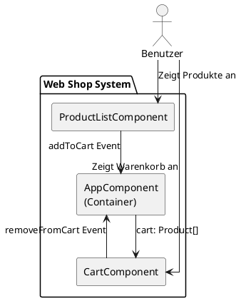
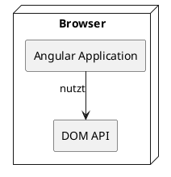
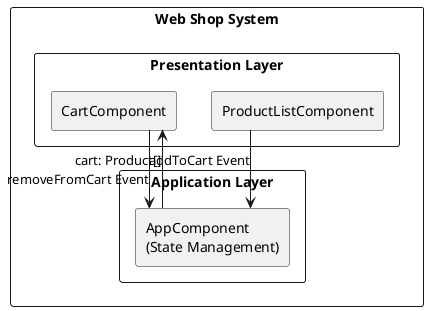
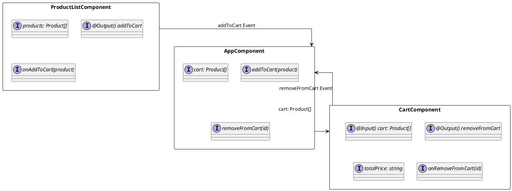
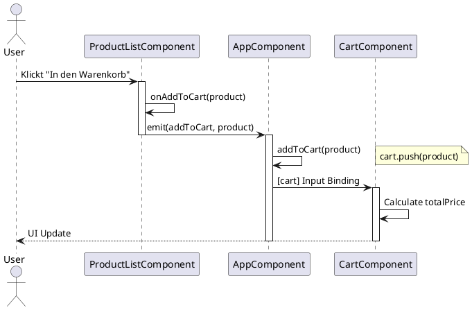
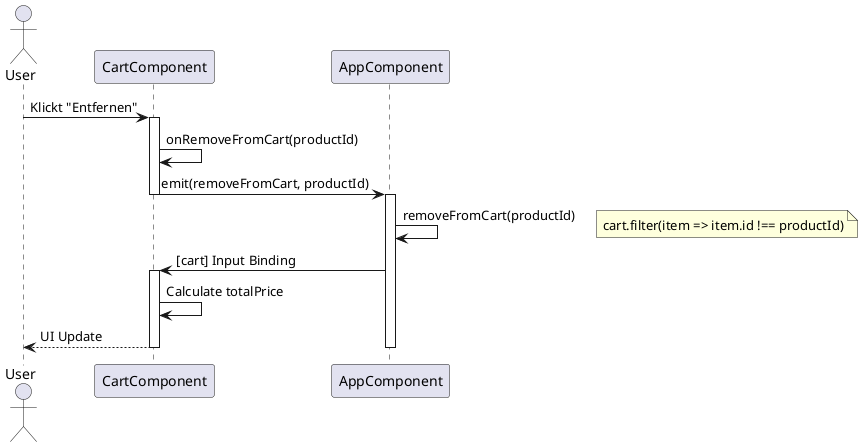
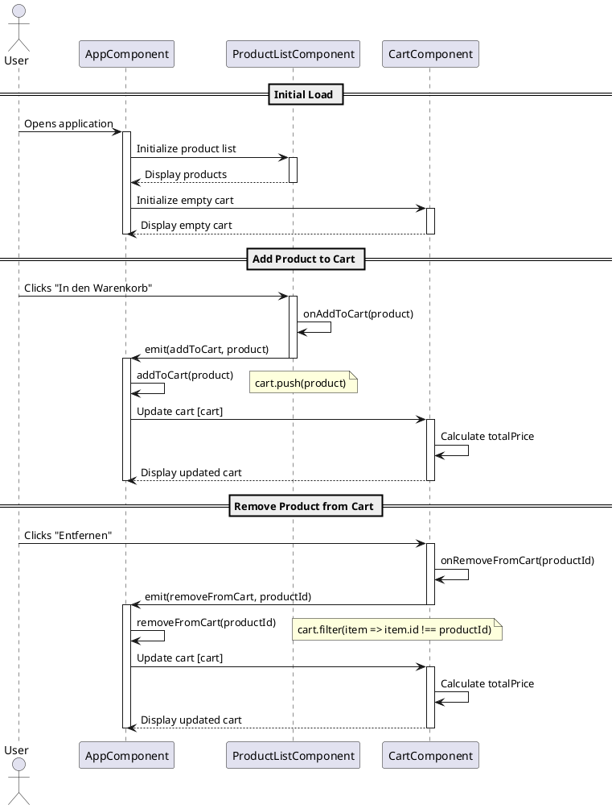
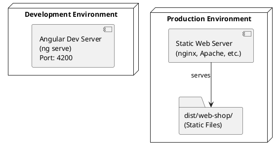
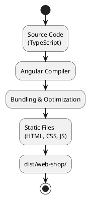

# arc42 Dokumentation: Web Shop

## 1. Einführung und Ziele

### 1.1 Anforderungen an die Dokumentation

Diese Dokumentation beschreibt die Architektur des Web Shop Systems. Sie richtet sich an:
- Entwickler, die am System arbeiten
- Architekten, die das System verstehen müssen
- Projektmanager, die einen Überblick benötigen

### 1.2 Ziele und Anforderungen

**Hauptziel:**
Entwicklung einer einfachen, funktionalen Web-Shop-Anwendung zur Demonstration von Angular-Komponenten und Event-basierter Kommunikation.

**Funktionale Anforderungen:**
- Anzeige einer Produktliste
- Hinzufügen von Produkten zum Warenkorb
- Entfernen von Produkten aus dem Warenkorb
- Berechnung und Anzeige der Gesamtsumme

**Nicht-funktionale Anforderungen:**
- Einfache, wartbare Code-Struktur
- Responsive Benutzeroberfläche
- Client-seitige Verarbeitung (kein Backend erforderlich)

### 1.3 Stakeholder

| Stakeholder | Interesse |
|------------|-----------|
| Entwickler | Verständnis der Architektur und Komponentenstruktur |
| Dozenten/Lehrende | Demonstration von Angular-Konzepten |
| Studenten/Lernende | Lernbeispiel für Angular-Entwicklung |

### 1.4 Qualitätsziele

| Priorität | Qualitätsziel | Beschreibung |
|-----------|---------------|--------------|
| 1 | Einfachheit | Klare, verständliche Struktur für Lernzwecke |
| 2 | Wartbarkeit | Gut strukturierter, dokumentierter Code |
| 3 | Benutzerfreundlichkeit | Intuitive Bedienung der Web-Shop-Oberfläche |

---

## 2. Randbedingungen

### 2.1 Technische Randbedingungen

- **Framework:** Angular 17.2.0
- **Sprache:** TypeScript 5.3.2
- **Build-Tool:** Angular CLI / Angular DevKit
- **Browser:** Moderne Browser mit ES6+ Support
- **Styling:** SCSS

### 2.2 Organisatorische Randbedingungen

- Verwendung von Angular als Frontend-Framework
- Keine Backend-Integration erforderlich
- Statische Produktdaten im Frontend

### 2.3 Konventionen

- Angular Style Guide
- TypeScript Best Practices
- Komponenten-basierte Architektur

---

## 3. Kontextabgrenzung

### 3.1 Fachlicher Kontext



*Siehe auch: `diagrams/context-fachlich.puml`*

**Akteure:**
- **Benutzer:** Interagiert mit der Web-Shop-Oberfläche

**Systemgrenze:**
- Client-seitige Angular-Anwendung
- Keine externe API oder Datenbank

### 3.2 Technischer Kontext



*Siehe auch: `diagrams/context-technisch.puml`*

**Externe Schnittstellen:**
- Browser DOM API
- Angular Framework APIs

---

## 4. Lösungsstrategie

### 4.1 Technische Entscheidungen

**Architektur-Pattern:**
- **Komponenten-basierte Architektur:** Angular Components
- **Event-basierte Kommunikation:** @Output() EventEmitter für Parent-Child-Kommunikation
- **State Management:** Lokaler State im AppComponent

**Technologie-Stack:**
- Angular 17 (Component-basiertes Framework)
- TypeScript (Typsicherheit)
- SCSS (Styling)
- RxJS (für zukünftige Erweiterungen)

### 4.2 Architekturprinzipien

1. **Separation of Concerns:** Jede Komponente hat eine klare Verantwortlichkeit
2. **Single Responsibility:** Komponenten sind fokussiert auf eine Aufgabe
3. **Component Communication:** Parent-Child-Kommunikation über Events und Inputs
4. **Datenfluss:** Unidirektionaler Datenfluss von Parent zu Child

---

## 5. Baustein-Sicht

### 5.1 Level 1: Übersicht



*Siehe auch: `diagrams/building-blocks-level1.puml`*

### 5.2 Level 2: Komponenten-Details

#### 5.2.1 AppComponent

**Verantwortlichkeit:**
- Root-Komponente der Anwendung
- State Management für den Warenkorb
- Koordination zwischen ProductList und Cart Komponenten

**Schnittstellen:**
- `cart: Product[]` - Warenkorb-Array
- `addToCart(product: Product): void` - Produkt zum Warenkorb hinzufügen
- `removeFromCart(productId: number): void` - Produkt aus Warenkorb entfernen

**Abhängigkeiten:**
- ProductListComponent
- CartComponent

#### 5.2.2 ProductListComponent

**Verantwortlichkeit:**
- Anzeige der Produktliste
- Bereitstellung der Funktionalität zum Hinzufügen von Produkten

**Schnittstellen:**
- `products: Product[]` - Statische Produktliste
- `@Output() addToCart: EventEmitter<Product>` - Event zum Hinzufügen
- `onAddToCart(product: Product): void` - Event-Handler

**Abhängigkeiten:**
- Keine (selbstständige Komponente)

#### 5.2.3 CartComponent

**Verantwortlichkeit:**
- Anzeige des Warenkorbs
- Berechnung der Gesamtsumme
- Entfernen von Produkten aus dem Warenkorb

**Schnittstellen:**
- `@Input() cart: Product[]` - Warenkorb-Daten
- `@Output() removeFromCart: EventEmitter<number>` - Event zum Entfernen
- `totalPrice: string` - Berechnete Gesamtsumme (Getter)
- `onRemoveFromCart(productId: number): void` - Event-Handler

**Abhängigkeiten:**
- Keine (selbstständige Komponente)

### 5.2.4 Komponenten-Übersicht



*Siehe auch: `diagrams/component-details.puml`*

### 5.3 Datenmodell

```typescript
interface Product {
  id: number;      // Eindeutige Produkt-ID
  name: string;    // Produktname
  price: number;   // Preis in CHF
}
```

---

## 6. Laufzeitsicht

### 6.1 Szenario: Produkt zum Warenkorb hinzufügen



*Siehe auch: `diagrams/runtime-add-to-cart.puml`*

**Schritte:**
1. Benutzer klickt auf "In den Warenkorb" Button
2. ProductListComponent ruft `onAddToCart(product)` auf
3. Event `addToCart` wird an AppComponent emittiert
4. AppComponent fügt Produkt zum `cart` Array hinzu
5. AppComponent übergibt aktualisiertes `cart` Array an CartComponent
6. CartComponent berechnet Gesamtsumme neu und aktualisiert die Anzeige

### 6.2 Szenario: Produkt aus Warenkorb entfernen



*Siehe auch: `diagrams/runtime-remove-from-cart.puml`*

**Schritte:**
1. Benutzer klickt auf "Entfernen" Button
2. CartComponent ruft `onRemoveFromCart(productId)` auf
3. Event `removeFromCart` wird an AppComponent emittiert
4. AppComponent filtert Produkt aus `cart` Array
5. AppComponent übergibt aktualisiertes `cart` Array an CartComponent
6. CartComponent berechnet Gesamtsumme neu und aktualisiert die Anzeige

### 6.3 Sequenzdiagramm - Komplett



*Siehe auch: `diagrams/sequence-complete.puml`*

---

## 7. Verteilungssicht

### 7.1 Deployment-Architektur



*Siehe auch: `diagrams/deployment.puml`*

### 7.2 Build-Prozess



*Siehe auch: `diagrams/build-process.puml`*

**Build-Konfiguration:**
- **Development:** Source Maps, keine Optimierung
- **Production:** Code Minification, Tree Shaking, Asset Optimization

---

## 8. Querschnittliche Konzepte

### 8.1 Architektur- und Entwurfsmuster

**Verwendete Patterns:**
- **Component Pattern:** Modularisierung der UI in wiederverwendbare Komponenten
- **Event-Driven Communication:** Loose Coupling durch Events
- **Container/Presenter Pattern:** AppComponent als Container, ProductList/Cart als Presenter

### 8.2 Sicherheit

- Keine Backend-Integration, daher keine Authentifizierung erforderlich
- Client-seitige Validierung (falls zukünftig erweitert)
- XSS-Schutz durch Angular's Template-Sanitization

### 8.3 Fehlerbehandlung

- Aktuell keine explizite Fehlerbehandlung implementiert
- Empfehlung für zukünftige Erweiterungen: Error Handling Service

### 8.4 Logging und Monitoring

- Aktuell kein Logging implementiert
- Browser DevTools für Debugging

### 8.5 Internationalisierung

- Aktuell nur Deutsch
- Keine i18n-Implementierung

### 8.6 Konfiguration

- Produktdaten hardcodiert in ProductListComponent
- Empfehlung: Auslagern in Service oder Konfigurationsdatei

---

## 9. Architekturentscheidungen

### 9.1 ADR-001: Verwendung von Angular als Framework

**Status:** Akzeptiert

**Kontext:**
Entwicklung einer Web-Shop-Anwendung als Lernbeispiel.

**Entscheidung:**
Angular 17 wird als Frontend-Framework verwendet.

**Konsequenzen:**
- ✅ Strukturierte, komponenten-basierte Architektur
- ✅ TypeScript für Typsicherheit
- ✅ Umfangreiches Ökosystem
- ⚠️ Lernkurve für Angular-spezifische Konzepte
- ⚠️ Größere Bundle-Größe im Vergleich zu Vanilla JS

### 9.2 ADR-002: Event-basierte Kommunikation zwischen Komponenten

**Status:** Akzeptiert

**Kontext:**
Kommunikation zwischen ProductListComponent, AppComponent und CartComponent.

**Entscheidung:**
Verwendung von Angular @Output() EventEmitter für Parent-Child-Kommunikation.

**Konsequenzen:**
- ✅ Loose Coupling zwischen Komponenten
- ✅ Klare Datenfluss-Richtung
- ✅ Einfach zu verstehen und zu testen
- ⚠️ Bei komplexeren Anwendungen könnte State Management (z.B. NgRx) sinnvoll sein

### 9.3 ADR-003: Lokales State Management im AppComponent

**Status:** Akzeptiert

**Kontext:**
Verwaltung des Warenkorb-Zustands.

**Entscheidung:**
Warenkorb-State wird direkt im AppComponent verwaltet.

**Konsequenzen:**
- ✅ Einfach für kleine Anwendungen
- ✅ Keine zusätzlichen Dependencies
- ⚠️ Bei größeren Anwendungen könnte ein State Management Service sinnvoll sein
- ⚠️ State ist nicht persistent (verloren bei Seiten-Reload)

---

## 10. Qualitätsanforderungen

### 10.1 Qualitätsbaum

```
Qualität
├── Funktionalität
│   ├── Produktliste anzeigen ✓
│   ├── Produkt zum Warenkorb hinzufügen ✓
│   ├── Produkt aus Warenkorb entfernen ✓
│   └── Gesamtsumme berechnen ✓
├── Benutzerfreundlichkeit
│   ├── Intuitive Bedienung ✓
│   └── Responsive Design (teilweise)
├── Wartbarkeit
│   ├── Klare Komponentenstruktur ✓
│   └── Dokumentierter Code (teilweise)
└── Performance
    ├── Schnelle Ladezeiten ✓
    └── Effiziente Rendering-Zyklen ✓
```

### 10.2 Qualitätsszenarien

| Szenario | Stimulus | Artefakt | Umgebung | Reaktion | Maß |
|----------|----------|----------|----------|----------|-----|
| Produkt hinzufügen | Benutzer klickt Button | ProductListComponent | Normal | Produkt erscheint im Warenkorb | < 100ms |
| Gesamtsumme berechnen | Warenkorb ändert sich | CartComponent | Normal | Gesamtsumme wird aktualisiert | < 50ms |
| Initiale Ladezeit | Seite wird geladen | Browser | Normal | Seite ist vollständig geladen | < 2s |

---

## 11. Risiken und technische Schulden

### 11.1 Risiken

| Risiko | Wahrscheinlichkeit | Auswirkung | Maßnahme |
|--------|-------------------|------------|----------|
| State-Verlust bei Reload | Hoch | Mittel | LocalStorage/SessionStorage implementieren |
| Keine Validierung | Mittel | Niedrig | Input-Validierung hinzufügen |
| Hardcodierte Produktdaten | Hoch | Niedrig | Service für Produktdaten implementieren |

### 11.2 Technische Schulden

1. **Hardcodierte Produktdaten**
   - **Aktuell:** Produkte sind direkt in ProductListComponent definiert
   - **Empfehlung:** ProductService implementieren
   - **Aufwand:** Niedrig

2. **Keine Persistenz**
   - **Aktuell:** Warenkorb geht bei Reload verloren
   - **Empfehlung:** LocalStorage für Warenkorb-Persistenz
   - **Aufwand:** Niedrig

3. **Fehlende Fehlerbehandlung**
   - **Aktuell:** Keine explizite Fehlerbehandlung
   - **Empfehlung:** Error Handling Service
   - **Aufwand:** Mittel

4. **Keine Tests**
   - **Aktuell:** Keine Unit-Tests vorhanden
   - **Empfehlung:** Jasmine/Karma Tests implementieren
   - **Aufwand:** Hoch

5. **Styling könnte verbessert werden**
   - **Aktuell:** Inline Styles in Komponenten
   - **Empfehlung:** Separate SCSS-Dateien oder CSS-Framework
   - **Aufwand:** Niedrig

---

## 12. Glossar

| Begriff | Erklärung |
|---------|-----------|
| **Angular** | TypeScript-basiertes Frontend-Framework von Google |
| **Component** | Wiederverwendbare UI-Einheit in Angular |
| **EventEmitter** | Angular-Mechanismus für Event-basierte Kommunikation |
| **NgModule** | Angular-Modul zur Gruppierung von Komponenten, Services, etc. |
| **Product** | Datenstruktur für ein Produkt (id, name, price) |
| **State Management** | Verwaltung des Anwendungszustands |
| **TypeScript** | Typisierte Superset-Sprache von JavaScript |
| **Warenkorb (Cart)** | Sammlung von ausgewählten Produkten |

---

## Anhang

### A.1 Projektstruktur

```
web-shop/
├── src/
│   ├── app/
│   │   ├── app.component.ts          # Root-Komponente
│   │   ├── app.module.ts             # Angular-Modul
│   │   └── components/
│   │       ├── product-list/
│   │       │   └── product-list.component.ts
│   │       └── cart/
│   │           └── cart.component.ts
│   ├── assets/                       # Statische Assets
│   ├── index.html                    # HTML-Einstiegspunkt
│   ├── main.ts                       # TypeScript-Einstiegspunkt
│   └── styles.scss                   # Globale Styles
├── angular.json                      # Angular-Konfiguration
├── package.json                      # Dependencies
├── tsconfig.json                     # TypeScript-Konfiguration
└── diagrams/                         # PlantUML Diagramme
    ├── context-fachlich.puml         # Fachlicher Kontext
    ├── context-technisch.puml        # Technischer Kontext
    ├── building-blocks-level1.puml   # Baustein-Sicht Level 1
    ├── component-details.puml        # Komponenten-Details
    ├── runtime-add-to-cart.puml      # Laufzeit: Produkt hinzufügen
    ├── runtime-remove-from-cart.puml # Laufzeit: Produkt entfernen
    ├── sequence-complete.puml        # Komplettes Sequenzdiagramm
    ├── deployment.puml               # Deployment-Architektur
    └── build-process.puml            # Build-Prozess
```

### A.2 Abhängigkeiten

**Produktions-Dependencies:**
- @angular/core: ^17.2.0
- @angular/common: ^17.2.0
- @angular/forms: ^17.2.0
- @angular/platform-browser: ^17.2.0
- rxjs: ~7.8.0
- zone.js: ~0.14.3

**Entwicklungs-Dependencies:**
- @angular/cli: ^17.2.0
- @angular-devkit/build-angular: ^17.2.0
- typescript: ^5.3.2

### A.3 Build und Deployment

**Development:**
```bash
npm install
ng serve
```

**Production Build:**
```bash
ng build --configuration production
```

**Output:** `dist/web-shop/` (statische Dateien für Web-Server)

---

**Dokumentationsversion:** 1.0  
**Erstellt:** 2024  
**Letzte Aktualisierung:** 2024

